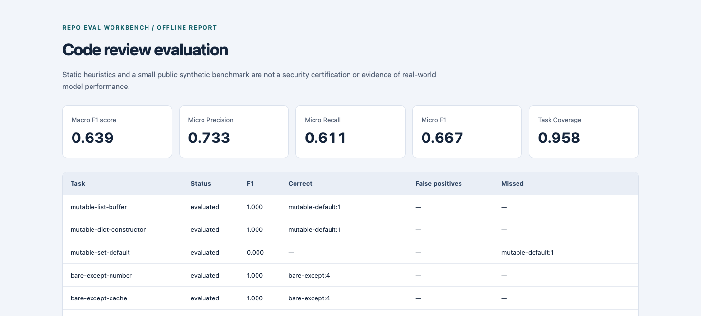

# Repo Eval Workbench

[](https://github.com/mstarpoli19/repo-eval-workbench/actions/workflows/ci.yml)

[](LICENSE)

**A small, inspectable toolkit for checking Python repositories and evaluating structured AI code reviews.**

Code-review evaluation needs more than a list of issues a model happened to find. It needs a defined target, a penalty for invented findings, and enough evidence to explain the score. This project makes those pieces explicit.

It has two independent workflows:

- **Audit a repository:** inspect Python syntax trees for four narrowly defined risk patterns, with file/line evidence and repository metadata checks. Target code is never imported or executed.
- **Evaluate a review:** compare JSONL predictions with an original synthetic dataset, measure false positives and missed findings, and export a deterministic JSON, Markdown, or standalone HTML report.

No model API key, GPU, database, or runtime dependency is required. The dataset contains 24 original cases (14 with target findings and 10 clean controls). The included predictions are illustrative, not output from a real model.

## Try it

```bash
git clone https://github.com/mstarpoli19/repo-eval-workbench.git
cd repo-eval-workbench
python3 -m venv .venv
source .venv/bin/activate
python -m pip install .

repo-eval audit examples/demo-repo --format markdown
repo-eval evaluate \
  --dataset data/benchmark.jsonl \
  --predictions data/example_predictions.jsonl \
  --format markdown
```

Python 3.11 or newer is required. Installation may download the setuptools build backend; the installed application and tests run offline. To use the source without installation:

```bash
PYTHONPATH=src python -m repo_eval_workbench --help
PYTHONPATH=src python -m unittest discover -s tests -v
```

## Inspect a result

The committed [example evaluation](reports/example-evaluation.md) shows every task's correct findings, false positives, and misses. [Download the HTML report](reports/example-evaluation.html) and open it locally for the same results in a readable, self-contained view. It has no scripts or external assets.



```bash
repo-eval evaluate --dataset data/benchmark.jsonl \
  --predictions data/example_predictions.jsonl \
  --format html --output review.html
```

Output files are created exclusively: the CLI refuses to overwrite an existing file. Use a new filename or remove an old report intentionally.

## What is checked?

| Rule | Target signal | Important limitation |
| --- | --- | --- |
| `mutable-default` | A mutable built-in container used as a function default | An intentional cache can be valid; arbitrary constructors are outside scope. |
| `bare-except` | An `except:` handler without an exception type | Sometimes deliberate; context still matters. |
| `shell-true` | A recognized subprocess call with literal `shell=True` | A risk signal, not proof of command injection. |
| `dynamic-exec` | A recognized built-in `eval` or `exec` call | Does not establish that its input is attacker-controlled. |

The scanner reports syntax, decoding, read, and limit problems rather than silently treating unprocessed files as clean. Metadata checks cover README, license, tests, and CI presence—not their quality. See [scope and safety](docs/scope-and-safety.md) before using it on another repository.

## How review scoring works

Each prediction names a task and a set of `(rule_id, line)` findings. For each supplied task:

`F1 = 2 × true positives / (2 × true positives + false positives + false negatives)`

The overall **0–1 score is the arithmetic mean of task F1 values**. An explicit empty review of a clean task scores 1; a missing task scores 0. Repeating findings cannot improve a score. Unknown tasks, duplicate records, unsupported rules, invalid line numbers, and malformed schemas are rejected.

Micro precision/recall/F1 and task coverage are reported separately. This avoids hiding a model's tendency to invent issues behind a single completion statistic. Full details, examples, and denominator conventions are in the [evaluation contract](docs/evaluation-contract.md).

## Reproduce the baseline

```bash
repo-eval baseline --dataset data/benchmark.jsonl --output baseline.jsonl
repo-eval evaluate --dataset data/benchmark.jsonl \
  --predictions baseline.jsonl --fail-under 0.90
python -m unittest discover -s tests -v
```

The baseline is the deterministic AST scanner, **not an LLM**. It is aligned with the same four rule definitions as the public dataset. A high score here does not demonstrate generalization, expert-level review, or performance on hidden data. The benchmark is a small engineering demonstration, not a competitive leaderboard.

## Engineering choices

- Strict input contracts: schema checks, duplicate detection, finite size limits, and useful validation failures.
- Separation of concerns: source analysis, scoring, reporting, and the CLI are independently testable.
- Deterministic artifacts: successful reports use relative paths and omit timestamps, so a result can be compared in CI.
- Conservative execution boundary: no target imports, shell commands, package installation, or model-output execution during an audit.
- CI on Python 3.11, 3.12, and 3.13, with read-only permissions and commit-pinned actions.

[Architecture](docs/architecture.md) · [Dataset card](docs/dataset-card.md) · [Contributing](CONTRIBUTING.md)

## Authorship and provenance

Created by Michael Starpoli as a new public portfolio project, with AI assistance for implementation, tests, and documentation. All benchmark samples were newly authored for this project. No employer/client code, private project data, or professional evaluation datasets are included. This is not a claim of prior production deployment or unaided authorship.

Licensed under [MIT](LICENSE).
